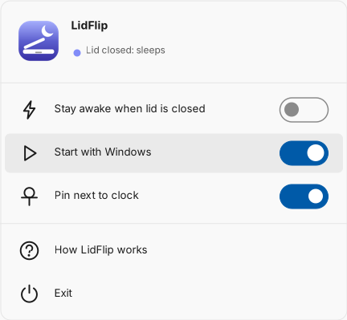
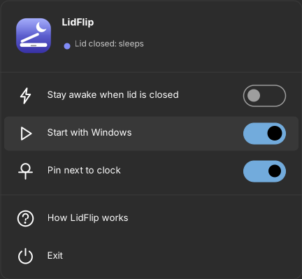
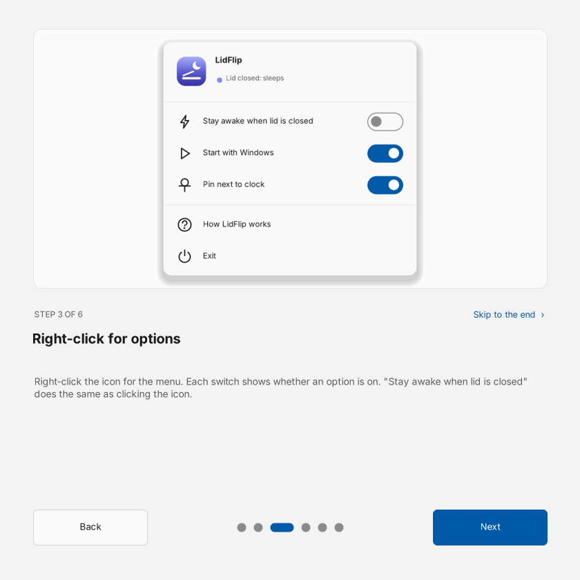
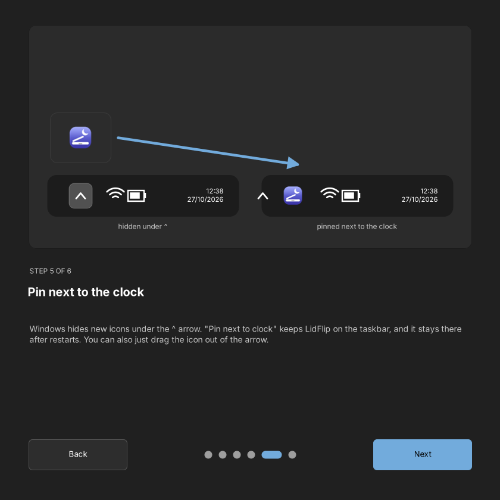
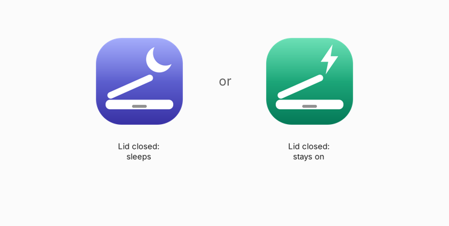
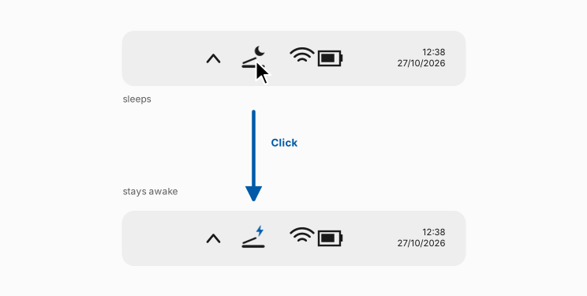
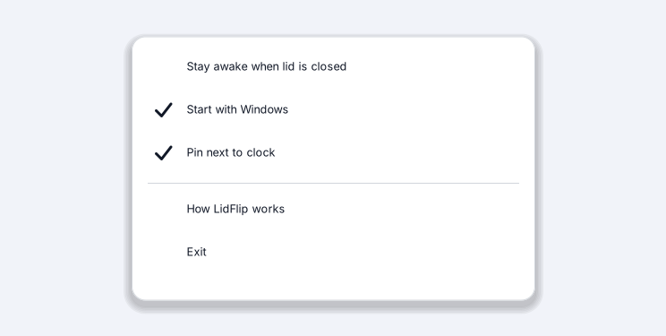
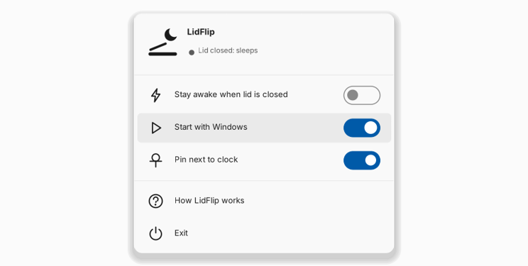
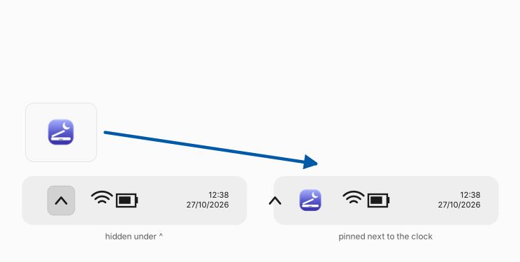
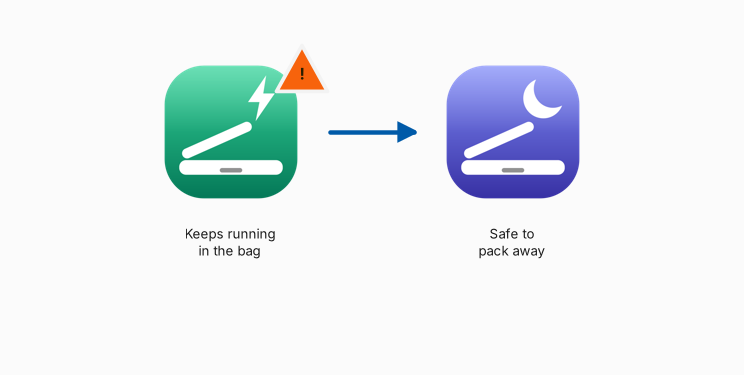

# LidFlip

**Keep your Windows laptop running with the lid closed — one click, right next to the clock.**

LidFlip is a tiny tray app that flips what happens when you close your laptop lid:
**sleep** 🌙 or **stay awake** ⚡.


Use it to keep downloads, builds, renders, remote desktop sessions or an external monitor running with the lid shut ("clamshell mode"), then flip back to normal sleep before the laptop goes in a bag.

### [⬇ Download LidFlip.exe](../../releases/latest/download/LidFlip.exe)

One small file (~80 KB). No installer, no admin rights, nothing else to install — it runs on any Windows 10 or 11.
[Code signing policy](#code-signing-policy) · [Privacy policy](#privacy-policy)

## Why not just use Windows settings?

You can — but the option is buried several screens deep, it has to be changed separately for battery and charger, and **some laptop makers hide it entirely**. LidFlip changes both in one click, shows the current state at a glance, and works even when the setting is hidden.

## Looks like part of Windows 11

LidFlip follows your Windows settings: light or dark mode, your **accent colour**, and the Windows 11 fonts and icons (Segoe UI Variable and Segoe Fluent Icons). On Windows 10 it falls back to the Windows 10 equivalents.

<p align="center"> </p>

## How it works

The first time you run LidFlip, a short guide walks you through it. You can open it again any time from the menu (**How LidFlip works**).

<p align="center"> </p>

### 1. Two states



The **moon** 🌙 means your laptop sleeps when you close the lid (the Windows default).
The **lightning bolt** ⚡ means it keeps running.

### 2. Click to flip



Click the LidFlip icon next to the clock to switch. The icon animates — the lid swings, the badge flips — so you know it worked.

### 3. Right-click for options



| Option | What it does |
|---|---|
| **Stay awake when lid is closed** | Same as clicking the icon. The switch shows the current state. |
| **Start with Windows** | Starts LidFlip when you sign in. |
| **Pin next to clock** | Keeps the icon out of the `^` overflow (Windows 11). |
| **How LidFlip works** | Opens the guide again. |
| **Exit** | Closes LidFlip. The lid setting stays as it is. |

### 4. Start with Windows



Turn this on so the icon is always there. Move `LidFlip.exe` to a permanent folder first (not Downloads) — Windows starts it from wherever it was when you ticked the option.

### 5. Pin next to the clock



Windows hides new tray icons under the `^` arrow. **Pin next to clock** keeps LidFlip on the taskbar and re-applies itself after restarts. On Windows 10, drag the icon out of the arrow instead.

### 6. Before it goes in a bag



With ⚡ on, a closed laptop keeps running and can overheat inside a bag. Flip back to 🌙 before you pack it.

## First launch: "Windows protected your PC"

LidFlip isn't code-signed (certificates cost money), so Windows SmartScreen may warn about an unknown app the first time. Click **More info → Run anyway**.
If you'd rather not trust a downloaded exe, build it yourself from the source in this repo — it takes seconds (see below). Each release also lists the SHA-256 checksum of `LidFlip.exe`.

## Uninstall

1. Right-click the icon → untick **Start with Windows** → **Exit**.
2. Delete `LidFlip.exe`.

To set the lid back to sleep, click the icon until it shows the 🌙 before you exit. LidFlip's own settings live in `HKCU\Software\LidFlip` and can be deleted too.

## Build from source

No Visual Studio needed — Windows already includes the C# compiler:

```
build.cmd
```

This produces `LidFlip.exe` next to the script. Releases are built the same way by GitHub Actions ([`.github/workflows/release.yml`](.github/workflows/release.yml)) whenever a `v*` tag is pushed.

## Under the hood

- The lid action is part of the active power plan (`SUB_BUTTONS` / `LIDACTION`): `0` = do nothing, `1` = sleep. LidFlip changes it with `powercfg` for both charger and battery.
- Some laptop makers hide this setting, so plain `powercfg /q` shows nothing. LidFlip reads it with `powercfg /qh`, which includes hidden settings.
- *Pin next to clock* sets `IsPromoted = 1` on LidFlip's entry under `HKCU\Control Panel\NotifyIconSettings`, and remembers the choice in `HKCU\Software\LidFlip`.
- *Start with Windows* uses `HKCU\Software\Microsoft\Windows\CurrentVersion\Run`.
- Icons and animation frames are drawn with GDI+ at the size your display needs, so they stay sharp at any scaling.
- Only one copy runs at a time; starting it again replaces the running copy.

The setting applies to the **current power plan**. If you switch plans, flip again.

## Project layout

```
src/Core.cs      entry point, power setting, startup, pin, settings
src/TrayApp.cs   tray icon, menu, flip animation
src/Art.cs       icon drawing
src/TrayMenu.cs  the Windows 11-style menu (switches, icons, animations)
src/Guide.cs     first-run guide window and its illustrations
src/Fluent.cs    Windows 11 colours, accent colour, fonts and icons
build.cmd        build with the compiler built into Windows
```

## Code signing policy

Free code signing provided by [SignPath.io](https://about.signpath.io), certificate by [SignPath Foundation](https://signpath.org).

- Release builds are made only by GitHub Actions from the source in this repository ([`release.yml`](.github/workflows/release.yml)), and every signing request is approved manually.
- Committers and reviewers: [iGreatMaster](https://github.com/iGreatMaster)
- Approvers: [iGreatMaster](https://github.com/iGreatMaster)

## Privacy policy

This program will not transfer any information to other networked systems unless specifically requested by the user or the person installing or operating it.
LidFlip makes no network connections at all: it only runs Windows' own `powercfg` and writes the registry keys listed in [Under the hood](#under-the-hood).

## License

[MIT](LICENSE)
