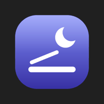
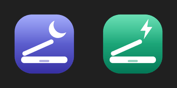

# LidToggle

A tiny Windows tray app that switches what happens when you **close your laptop lid**:
**sleep** 🌙 or **stay awake** ⚡ — with one click, right next to the clock.



Handy for keeping downloads, builds, remote sessions or an external monitor running with the lid shut, then flipping back to normal sleep before the laptop goes in a bag.

## Features

- **One click** on the tray icon toggles the lid-close action (both on charger and on battery)
- **Clear icon**: half-shut laptop + moon (sleeps) or lightning bolt (stays awake), with a transition animation
- **Start with Windows** and **Pin next to clock** options in the right-click menu
- Remembers the pin choice across restarts
- **Single instance**: launching it again replaces the running copy (never two icons)
- No admin rights, no installer framework, no dependencies — plain PowerShell + WinForms
- Errors are shown in a dialog and written to `LidToggle.log`



## Requirements

- Windows 10 or 11
- Windows PowerShell 5.1 (built into Windows)
- *Pin next to clock* uses a Windows 11 setting; on Windows 10, drag the icon out of the `^` overflow manually

## Install

1. Download the repo (**Code → Download ZIP**) and extract it.
2. Double-click **`Install.cmd`**.

This copies the app to `%LOCALAPPDATA%\LidToggle`, adds it to startup, and starts it.
If the icon is hidden under the `^` arrow, right-click it → **Pin next to clock**.

### Run without installing

Double-click `src\LidToggle.vbs` (it starts the script with no console window).

## Usage

| Action | Result |
|---|---|
| Left-click icon | Toggle sleep ↔ stay awake |
| Right-click → *Stay awake when lid is closed* | Same toggle, with a check mark showing the current state |
| Right-click → *Start with Windows* | Add/remove the startup shortcut |
| Right-click → *Pin next to clock* | Keep the icon out of the `^` overflow |
| Right-click → *Exit* | Quit |

> ⚠️ With **stay awake** on, the laptop keeps running when closed. Don't put it in a bag like that — it can overheat and drain the battery.

## Uninstall

Double-click **`Uninstall.cmd`**. It stops the app, removes the startup shortcut, the app folder and its registry key, and sets the lid action back to **Sleep**.
To leave the lid setting as it is:

```powershell
powershell -ExecutionPolicy Bypass -File uninstall.ps1 -KeepLidSetting
```

## How it works

- The lid action lives in the active power plan (`SUB_BUTTONS` / `LIDACTION`): `0` = do nothing, `1` = sleep. It is changed with `powercfg /setacvalueindex` and `/setdcvalueindex`.
- Some laptop makers hide this setting, so plain `powercfg /q` shows nothing; the app reads it with `powercfg /qh`, which includes hidden settings.
- *Pin next to clock* sets `IsPromoted = 1` for the app's entry under `HKCU\Control Panel\NotifyIconSettings` (Windows 11). The choice is saved in `HKCU\Software\LidToggle` and re-applied on launch.
- Icons and animation frames are drawn at 256 px with GDI+ and downscaled to 32 px, generated once at startup.
- A named mutex keeps one instance; a new launch signals the old one through a named event to quit, then takes over.

The setting applies to the **current power plan**. If you switch plans, toggle again in the new plan.

## Project layout

```
src/LidToggle.ps1   the app
src/LidToggle.vbs   silent launcher (no console window)
install.ps1         per-user install + startup shortcut
uninstall.ps1       removal + restore lid action to Sleep
Install.cmd         double-click wrapper for install.ps1
Uninstall.cmd       double-click wrapper for uninstall.ps1
```

## License

[MIT](LICENSE)
